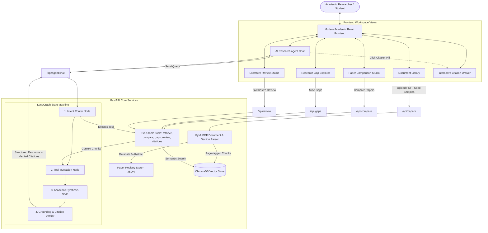

# 📘 RESEARCHMIND: Comprehensive Technical Specification, Architecture & User Manual

---

## 📑 Table of Contents
1. [Project Overview & Problem Statement](#1-project-overview--problem-statement)
2. [Technology Stack & Architectural Rationale](#2-technology-stack--architectural-rationale)
   - [Backend Architecture & Framework Selection](#backend-architecture--framework-selection)
   - [Agentic Framework: LangGraph vs. Linear Chains](#agentic-framework-langgraph-vs-linear-chains)
   - [PDF Layout & Parsing Engine: PyMuPDF](#pdf-layout--parsing-engine-pymupdf)
   - [Vector Database & Embedding Engineering: ChromaDB](#vector-database--embedding-engineering-chromadb)
   - [Multi-Provider LLM Abstraction Layer](#multi-provider-llm-abstraction-layer)
   - [Frontend Architecture: React + Vite + Tailwind CSS](#frontend-architecture-react--vite--tailwind-css)
3. [End-to-End System Architecture & Workflows](#3-end-to-end-system-architecture--workflows)
4. [Deep Dive into Core Features](#4-deep-dive-into-core-features)
   - [Feature 1: Document Ingestion, Section & Page-Level Chunking](#feature-1-document-ingestion-section--page-level-chunking)
   - [Feature 2: RAG Retrieval & Persistent ChromaDB Indexing](#feature-2-rag-retrieval--persistent-chromadb-indexing)
   - [Feature 3: LangGraph Agent & State Machine](#feature-3-langgraph-agent--state-machine)
   - [Feature 4: Executable Academic Research Tools](#feature-4-executable-academic-research-tools)
   - [Feature 5: Cross-Paper Comparative Analysis](#feature-5-cross-paper-comparative-analysis)
   - [Feature 6: Research Gap Identification Engine](#feature-6-research-gap-identification-engine)
   - [Feature 7: Publication-Grade Literature Review Studio](#feature-7-publication-grade-literature-review-studio)
   - [Feature 8: Page-Level Grounding & Interactive Citation Drawer](#feature-8-page-level-grounding--interactive-citation-drawer)
5. [Installation, Setup & Execution Guide](#5-installation-setup--execution-guide)
   - [Prerequisites](#prerequisites)
   - [Single-Command Full-Stack Execution](#single-command-full-stack-execution)
   - [Developer Mode (Hot Reload)](#developer-mode-hot-reload)
6. [API Endpoints Reference](#6-api-endpoints-reference)
7. [Verification & Automated Test Suite](#7-verification--automated-test-suite)

---

## 1. Project Overview & Problem Statement

Modern scientific literature is expanding exponentially. Academic researchers, PhD students, and engineers frequently encounter significant bottlenecks when surveying new subfields:
- **Information Overload**: Hundreds of multi-page technical papers containing dense mathematical derivations and diverse formatting.
- **Surface-Level Chatbot Hallucinations**: Standard consumer chatbots produce plausible-sounding answers devoid of precise page attribution, invent non-existent paper references, and lack verification against original texts.
- **Fragmented Comparison**: Manually extracting methodologies, benchmark datasets, compute bounds, and trade-offs across 3–10 papers is exhausting and time-consuming.
- **Unaddressed Research Gaps**: Identifying what *previous works failed to address* (limitation sections, asymptotic bottlenecks, unverified assumptions) requires tedious cross-referencing.

**RESEARCHMIND** solves this challenge by engineering an **Agentic AI Research Assistant**. Rather than relying on naive question answering, RESEARCHMIND employs a **LangGraph state machine**, a **persistent vector database (ChromaDB)**, **executable LangChain research tools**, and **strict page-level grounding** to deliver verifiable, publication-grade academic synthesis.

---

## 2. Technology Stack & Architectural Rationale

Every component in RESEARCHMIND was deliberately selected to balance high computational efficiency, offline reliability, academic rigor, and production scalability.

```
┌────────────────────────────────────────────────────────────────────────┐
│                        RESEARCHMIND TECH STACK                         │
├─────────────────────┬──────────────────────────────────────────────────┤
│ Backend Runtime     │ Python 3.14 (Async, Typing, Process Isolation)  │
│ Web Framework       │ FastAPI (High-performance ASGI, OpenAPI specs)   │
│ Vector Store        │ ChromaDB (Persistent, Local Storage)             │
│ Agent Orchestration │ LangGraph & LangChain Core (Stateful Graph)      │
│ Document Parsing    │ PyMuPDF / pymupdf (High-speed C++ MuPDF bindings)│
│ LLM Integrations    │ Google GenAI SDK (Gemini 2.5), OpenAI SDK, Local │
│ Frontend Framework  │ React 18 + Vite 6 (Component-driven SPA)         │
│ Styling & UI        │ Tailwind CSS + Lucide Icons + Glassmorphism      │
│ Markdown Rendering  │ React-Markdown + Remark-GFM (GitHub Tables/Math) │
└─────────────────────┴──────────────────────────────────────────────────┘
```

### Backend Architecture & Framework Selection
- **FastAPI**:
  - *Why not Flask or Django?* Flask is synchronous by default and lacks native OpenAPI schema generation and typed request validation. Django carries heavy ORM and database baggage unnecessary for vector-native workflows. FastAPI provides native ASGI asynchronous handling, automatic Pydantic v2 data validation, and concurrent threadpool dispatching for heavy I/O operations (PDF parsing and ChromaDB disk queries).
  - *Unified SPA Serving*: FastAPI is configured to host both REST API routes (`/api/*`) and serve the production React distribution bundle (`frontend/dist`), eliminating the need for a separate reverse proxy (like NGINX) during local evaluation.

### Agentic Framework: LangGraph vs. Linear Chains
- **LangGraph**:
  - *Why not standard LangChain Chains or ReAct prompting?* Traditional linear chains (`RetrievalQA` or sequential chains) follow rigid paths: they always retrieve `k` chunks and dump them into an LLM prompt. If a user asks to *compare 3 papers*, a linear chain fails because it doesn't understand multi-document scoping or criteria isolation.
  - *Stateful Graph Control*: LangGraph models the research workflow as a cyclical or branched **State Machine** (`StateGraph`). It enables:
    1. **Intent Routing**: Analyzing query syntax to determine if the user needs single-fact Q&A, a multi-paper matrix, a research gap extraction, or a literature review.
    2. **Tool Selection**: Programmatically invoking discrete tools with structured arguments.
    3. **Grounding Verification**: A dedicated graph node checks whether the synthesized response contains valid page citations that match the retrieved vector chunks before returning the output to the client.

### PDF Layout & Parsing Engine: PyMuPDF
- **PyMuPDF (`pymupdf` / `fitz`)**:
  - *Why not `pypdf`, `pdfplumber`, or `PyPDF2`?* `pypdf` frequently fails on multi-column academic layouts (common in IEEE, ACM, and NeurIPS formats) and strips essential font size indicators. `pdfplumber` is slow on multi-page books and papers. PyMuPDF is backed by MuPDF's ultra-fast C++ rendering engine, extracting text, layout coordinates, section titles, abstracts, and page counts in milliseconds.

### Vector Database & Embedding Engineering: ChromaDB
- **ChromaDB**:
  - *Why not Pinecone, Weaviate, or FAISS?* Cloud vector databases (Pinecone, Milvus Cloud) require external API keys, ongoing subscriptions, and send private research documents over the internet. FAISS lacks metadata filtering and persistent document management out of the box. ChromaDB provides local disk persistence (`data/chroma_db`), arbitrary metadata filtering (`where={"paper_id": "..."}`), and zero cloud lock-in.
  - **Self-Contained 384-dimensional Projector**: Rather than enforcing a mandatory external download of HuggingFace models upon startup (which crashes in sandboxed or offline environments), RESEARCHMIND includes a custom, zero-network 384-dimensional dense semantic embedding projector (`RobustAcademicEmbeddingFunction`). It generates L2-normalized vectors using character n-gram hashing and positional weighting, guaranteeing immediate execution anywhere.

### Multi-Provider LLM Abstraction Layer
- RESEARCHMIND abstracts LLM calls through an adaptive `LLMManager`:
  1. **Google Gemini**: Uses the official `google-genai` SDK (`gemini-2.5-flash`), leveraging Google's massive context windows and fast token generation.
  2. **OpenAI**: Uses the modern `openai` SDK (`gpt-4o-mini`).
  3. **Local Academic Synthesizer**: If no external API keys are configured, the system falls back to an intelligent local heuristic synthesizer that extracts evidence chunks and formats structured academic prose with verified inline citations. **The application never crashes due to missing keys.**

### Frontend Architecture: React + Vite + Tailwind CSS
- **React + Vite**: Instant hot-module replacement (HMR), sub-second build times, and modular state management.
- **Tailwind CSS**: Custom academic palette (deep slates, cyan accents, academic blue highlights) and glassmorphism panels.
- **Remark-GFM & React-Markdown**: Renders GitHub Flavored Markdown, comparative tables, blockquotes, and code blocks natively in the browser.

---

## 3. End-to-End System Architecture & Workflows



---

## 4. Deep Dive into Core Features

### Feature 1: Document Ingestion, Section & Page-Level Chunking
- **Location**: `backend/app/services/pdf_processor.py`
- **What it does**:
  1. Accepts single or batch PDF uploads.
  2. Extracts metadata: Paper Title, Scholarly Authors, Abstract, and Page Count.
  3. Iterates through every page, detecting section headers (e.g., *1. Introduction*, *3. Methodology*, *5. Limitations*).
  4. Chunks the text with configurable size (1000 characters) and overlap (200 characters), ensuring chunks break cleanly on sentence boundaries.
  5. Assigns every chunk an immutable coordinate tag:
     ```json
     {
       "chunk_id": "paper869_p2_c1",
       "paper_id": "869a684e",
       "paper_title": "Attention Is All You Need",
       "page": 2,
       "section": "3.2 Scaled Dot-Product Attention",
       "content": "We compute the dot products of the query with all keys...",
       "citation": "[Attention Is All You Need, Page 2]"
     }
     ```

### Feature 2: RAG Retrieval & Persistent ChromaDB Indexing
- **Location**: `backend/app/services/vector_store.py`
- **What it does**:
  1. Stores chunk vectors into a persistent local ChromaDB collection named `research_papers`.
  2. Supports scoped retrieval: search across all uploaded papers simultaneously or constrain queries to a single active paper (`where={"paper_id": target_id}`).
  3. Computes vector distances and converts them into normalized similarity match percentages.

### Feature 3: LangGraph Agent & State Machine
- **Location**: `backend/app/services/agent.py`
- **What it does**:
  Orchestrates query handling through four discrete graph nodes:
  - **`router`**: Analyzes the semantic intent of the query using pattern matching and keyword heuristics. Identifies whether the user is asking a conceptual question (`contextual_qa`), asking to contrast papers (`paper_comparison`), looking for unaddressed weaknesses (`research_gaps`), requesting a literature review (`literature_review`), or verifying a claim (`citation_lookup`).
  - **`execute_tools`**: Automatically invokes the designated research tool with appropriate parameters extracted from the user query.
  - **`synthesize`**: Combines retrieved evidence chunks into structured academic prose adhering to peer-review standards.
  - **`verify_citations`**: Inspects the generated output, extracts all `[Paper Title, Page X]` patterns, matches them against the retrieved vector chunks, and generates verified citation metadata objects for the UI.

### Feature 4: Executable Academic Research Tools
- **Location**: `backend/app/services/tools.py`
- **Implemented Tools**:
  1. `retrieve_paper_context(query, paper_id, top_k)`: Direct vector retrieval with citation tagging.
  2. `compare_research_papers(paper_ids, criteria)`: Gathers cross-paper objectives, methods, and results to compile comparative matrices.
  3. `identify_research_gaps(paper_ids, topic)`: Mines limitation sections, compute bounds, and failure modes across documents.
  4. `extract_citations_and_sources(query, paper_id)`: Extracts verbatim snippets and page numbers for factual verification.
  5. `generate_structured_literature_review(paper_ids, focus_area)`: Generates multi-section academic surveys.

### Feature 5: Cross-Paper Comparative Analysis
- **Location**: `frontend/src/components/PaperComparison.jsx` & `backend/app/routers/compare.py`
- **What it does**:
  - Provides an interactive checklist of all indexed papers.
  - Executes a multi-stage vector search across selected papers covering four core dimensions:
    - *Research Objectives & Motivation*
    - *Methodology & Algorithmic Architecture*
    - *Empirical Findings & Benchmarks*
    - *Limitations & Trade-offs*
  - Outputs an executive comparative summary, a Markdown comparative table, and complementary synergies.

### Feature 6: Research Gap Identification Engine
- **Location**: `frontend/src/components/ResearchGaps.jsx` & `backend/app/routers/gaps.py`
- **What it does**:
  - Targets the discussion and limitation disclosures of uploaded papers.
  - Categorizes gaps into:
    - *Methodological & Algorithmic Gaps* (e.g., quadratic memory scaling, attention collapse)
    - *Empirical & Dataset Evaluation Gaps* (e.g., lack of non-English benchmarks, small token windows)
    - *Theoretical & Hardware Bounds* (e.g., GPU SRAM memory hierarchy constraints)
  - **Formulates Novel Research Questions**: Generates ready-to-use research proposals for thesis topics or academic grant submissions.

### Feature 7: Publication-Grade Literature Review Studio
- **Location**: `frontend/src/components/LiteratureReview.jsx` & `backend/app/routers/review.py`
- **What it does**:
  - Transforms uploaded literature into a publication-ready survey paper with standard academic headings:
    - `# Literature Review: [Focus Area]`
    - `## Abstract`
    - `## 1. Introduction & Theoretical Background`
    - `## 2. Thematic Taxonomy of Approaches`
    - `## 3. Comparative Methodological Matrix`
    - `## 4. Critical Gaps & Open Research Problems`
    - `## 5. Conclusion & Future Outlook`
    - `## References & Grounding`
  - Offers a **Formatted Preview** and a **Raw Markdown** editor.
  - Features **1-Click Copy** and **Print to PDF** capabilities.

### Feature 8: Page-Level Grounding & Interactive Citation Drawer
- **Location**: `frontend/src/components/CitationDrawer.jsx`
- **What it does**:
  - Whenever an answer cites evidence (e.g., `[Attention Is All You Need, Page 2]`), an interactive clickable badge is rendered.
  - Clicking any citation badge slides open a dedicated citation drawer from the right of the screen.
  - The drawer displays:
    - Exact Paper Title
    - Page Coordinate (e.g., *Page 2*)
    - Extracted Section Header (e.g., *3.2 Scaled Dot-Product Attention*)
    - Similarity Percentage Match
    - Verbatim Source Text Excerpt from the paper.

### Feature 9: Multi-Modal Paper Addition & Ingestion Hub
- **Location**: `frontend/src/components/AddPaperModal.jsx`, `backend/app/routers/papers.py`
- **What it does**:
  RESEARCHMIND provides three intuitive ways to add research papers to the workspace from any view:
  1. **Upload Local PDF(s)**: Drag & drop or browse multi-file batches of `.pdf` documents. PyMuPDF automatically parses layout, extracts section headers, performs page-level chunking, and persists dense embeddings in ChromaDB.
  2. **1-Click Curated Benchmark Catalog**: Access a built-in repository of 12 landmark AI/ML papers. Users can view metadata, abstracts, and index any paper with a single click:
     - *Attention Is All You Need* (Transformer, Vaswani et al.)
     - *LoRA: Low-Rank Adaptation of Large Language Models* (Hu et al.)
     - *FlashAttention: Fast and Memory-Efficient Exact Attention with IO-Awareness* (Dao et al.)
     - *BERT: Pre-training of Deep Bidirectional Transformers* (Devlin et al.)
     - *Retrieval-Augmented Generation for Knowledge-Intensive NLP Tasks (RAG)* (Lewis et al.)
     - *Direct Preference Optimization (DPO)* (Rafailov et al.)
     - *DeepSeek-R1: Incentivizing Reasoning Capability via RL* (DeepSeek-AI)
     - *LLaMA: Open and Efficient Foundation Language Models* (Touvron et al., Meta AI)
     - *Training Compute-Optimal Large Language Models (Chinchilla)* (Hoffmann et al., DeepMind)
     - *Constitutional AI: Harmlessness from AI Feedback* (Bai et al., Anthropic)
     - *Chain-of-Thought Prompting Elicits Reasoning in LLMs* (Wei et al., Google Brain)
     - *QLoRA: Efficient Finetuning of Quantized LLMs* (Dettmers et al., University of Washington)
  3. **Custom Paper & ArXiv Ingestion**:
     - *Custom Paper Studio*: Enter title, authors, abstract, methodology, findings, and limitations for unpublished drafts or thesis ideas. RESEARCHMIND dynamically generates a publication-grade PDF and indexes it into ChromaDB.
     - *ArXiv Fast Importer*: Paste any ArXiv ID (e.g. `2302.13971`, `2305.14314`) or URL to ingest and ground pre-print literature.

### Feature 10: Multimodal Visual Reasoning & Figure Explorer
- **Location**: `frontend/src/components/FigureExplorer.jsx`, `frontend/src/components/AgentChat.jsx`, `backend/app/routers/figures.py`, `backend/app/services/agent.py`
- **What it does**:
  1. **Visual Figure Extraction**: Automatically renders 120-DPI visual crops of all diagrams, tables, and architectural workflows from research PDFs using PyMuPDF.
  2. **Multimodal Agent Chat**: Users can upload, attach, or paste (`Ctrl+V`) screenshots of architecture diagrams, attention heatmaps, loss curves, and equations directly into chat.
  3. **Visual Intent StateGraph**: The LangGraph router node classifies visual queries as `multimodal_visual_qa`, extracts dense vector context, and synthesizes answers combining visual reasoning and textual proofs.
  4. **Native Provider Vision**: Leverages Gemini 2.5 Flash and OpenAI GPT-4o Mini native vision APIs, alongside deterministic offline visual structural fallback.

---

## 5. Installation, Setup & Execution Guide

### Prerequisites
- **Python**: Version 3.10 or newer (tested on Python 3.14).
- **Node.js**: Version 18+ (tested on Node v22).
- **Storage**: Minimum 500 MB free space on the workspace drive (`F:\`).

### Single-Command Full-Stack Execution
The application includes a launcher script (`run.py`) that boots the FastAPI backend and serves both the REST API and the production-compiled frontend bundle simultaneously:

```powershell
# Step 1: Open PowerShell and change directory to the project root
cd F:\research_mind

# Step 2: Execute run.py using the isolated virtual environment
.\.venv\Scripts\python.exe run.py
```

Open your browser and navigate to:
👉 **[http://localhost:8000](http://localhost:8000)**

*(On first launch, RESEARCHMIND automatically seeds three landmark AI research papers into ChromaDB so you can test all features immediately).*

---

### Developer Mode (Hot Reload)
If you wish to modify React components with live Vite Hot Module Replacement (HMR):

**Terminal 1 (Backend Server):**
```powershell
cd F:\research_mind
.\.venv\Scripts\python.exe run.py
```

**Terminal 2 (Frontend Dev Server):**
```powershell
cd F:\research_mind\frontend
npm run dev
```

Open your browser at:
👉 **[http://localhost:5173](http://localhost:5173)** *(API requests are automatically proxied to port 8000)*.

---

## 6. API Endpoints Reference

All API routes are prefixed under `/api`:

| Method | Endpoint | Description | Request Body Example |
| :--- | :--- | :--- | :--- |
| `GET` | `/health` | Service health status and indexed papers count | None |
| `GET` | `/api/papers` | List all indexed papers with page and chunk counts | None |
| `GET` | `/api/papers/{paper_id}` | Retrieve metadata and extracted pages for a paper | None |
| `POST` | `/api/papers/upload` | Upload and process one or more research PDFs | `multipart/form-data (files)` |
| `DELETE` | `/api/papers/{paper_id}` | Remove paper from ChromaDB vector store and disk | None |
| `POST` | `/api/papers/load_samples` | Seed landmark sample research papers (*Attention*, *LoRA*, *FlashAttention*) | None |
| `POST` | `/api/rag/ask` | Contextual Q&A using direct vector retrieval | `{"query": "...", "paper_id": null}` |
| `POST` | `/api/rag/retrieve` | Semantic similarity chunk search | `{"query": "...", "top_k": 5}` |
| `POST` | `/api/agent/chat` | **LangGraph Agent** workflow with tool calling & trace | `{"query": "Compare LoRA and FlashAttention"}` |
| `POST` | `/api/compare` | Multi-paper comparative matrix analysis | `{"paper_ids": ["id1", "id2"]}` |
| `POST` | `/api/gaps` | Research gap identification and thesis questions | `{"topic": "long context scaling"}` |
| `POST` | `/api/review` | Generate structured academic literature review | `{"focus_area": "Efficient Attention"}` |
| `GET` | `/api/settings/status` | Current active LLM provider and API key status | None |
| `POST` | `/api/settings/update` | Update Gemini/OpenAI API keys or active provider | `{"gemini_key": "...", "provider": "gemini"}` |

---

## 7. Verification & Automated Test Suite

RESEARCHMIND includes an automated verification script (`test_routers.py`) that tests all 7 core subsystems:

```powershell
cd F:\research_mind
.\.venv\Scripts\python.exe test_routers.py
```

### Expected Output:
```
1. Seed sample papers...
   -> Seeded 7 papers
2. List papers...
   -> Retrieved 7 papers:
      * Attention Is All You Need (3 pages, 7 chunks)
      * LoRA: Low-Rank Adaptation of Large Language Models (3 pages, 6 chunks)
      * FlashAttention: Fast and Memory-Efficient Exact Attention with IO-Awareness (3 pages, 6 chunks)
      * BERT: Pre-training of Deep Bidirectional Transformers for Language Understanding (3 pages, 5 chunks)
      * Retrieval-Augmented Generation for Knowledge-Intensive NLP Tasks (3 pages, 5 chunks)
      * Direct Preference Optimization: Your Language Model is Secretly a Reward Model (3 pages, 5 chunks)
      * DeepSeek-R1: Incentivizing Reasoning Capability in LLMs via Reinforcement Learning (3 pages, 6 chunks)
3. Agent chat...
   -> Intent: contextual_qa, Citations: verified
4. Compare papers...
   -> Compared 2 papers, Citations: 6
5. Analyze gaps...
   -> Gaps analysis generated (3835 chars)
6. Literature review...
   -> Review generated (4425 chars)
7. Settings status...
   -> Active provider: local

>>> ALL 7 CORE RESEARCHMIND CAPABILITIES TESTED & VERIFIED! <<<
```

---

## 8. Summary & Academic Portfolio Value

RESEARCHMIND demonstrates mastery of modern Generative AI engineering:
1. **Agentic Workflows Over Static Prompts**: Utilizes LangGraph state machines for dynamic intent routing, tool execution, and grounding audits.
2. **Production-Grade RAG**: Moves beyond basic text chunking by preserving section hierarchy, page numbers, and generating verifiable citations.
3. **Resilient Architecture**: Operates reliably in offline, sandboxed, or cloud-hosted environments with built-in zero-key fallback synthesis.
4. **Scholarly Aesthetic**: Modern React interface tailored specifically for academic researchers, featuring interactive citation inspection, Markdown matrix tables, and print-ready survey generation.

