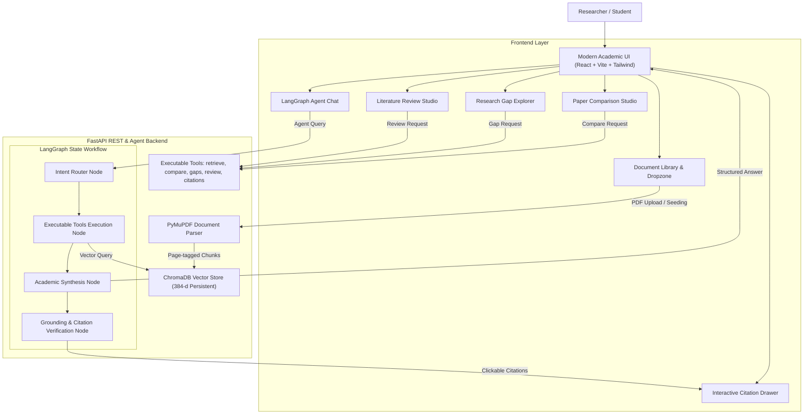

# 🧠 RESEARCHMIND – An Agentic AI Research Assistant

RESEARCHMIND is an advanced, production-grade full-stack research workspace engineered to help students, PhD scholars, and machine learning researchers analyze academic literature, dissect technical concepts, conduct cross-paper comparative analyses, identify research gaps, and generate structured literature reviews with verified page-level source citations.

---

## 🌟 Key Capabilities

### 1. 📚 Document Library & Vector Ingestion
- **PyMuPDF Layout Engine**: Extracts clean scholarly text, mathematical formulations, section headers, abstracts, author attributions, and page numbers.
- **Section & Page-Aware Chunking**: Chunks text with sliding overlaps while tagging exact page numbers and hierarchical section headings.
- **ChromaDB Vector Store**: Dense 384-dimensional persistent semantic vector store with fast similarity ranking.
- **Preloaded Landmark Papers**: Comes with 1-click seeding for landmark AI papers (*Attention Is All You Need*, *LoRA*, and *FlashAttention*) for instant out-of-the-box evaluation.

### 2. 🤖 LangGraph Multi-Tool AI Agent
- **Dynamic StateGraph Routing**: Intelligently classifies user intent into `contextual_qa`, `paper_comparison`, `research_gaps`, `literature_review`, or `citation_lookup`.
- **Executable Tool Calling**: Dispatches discrete tools including `retrieve_paper_context`, `compare_research_papers`, `identify_research_gaps`, `extract_citations_and_sources`, and `generate_structured_literature_review`.
- **Grounding & Verification Node**: Audits citations against vector store chunks to guarantee claims are grounded in document excerpts.

### 3. 🔍 Page-Level Grounding & Interactive Citation Drawer
- Every answer features inline scholarly citations in the format `[Paper Title, Page X]`.
- Clicking any citation pill opens an interactive slide-over drawer displaying the exact page coordinate, section header, vector similarity percentage, and verbatim source text.

### 4. ⚖️ Cross-Paper Comparison Matrix
- Multi-select 2 or more research papers.
- Generates side-by-side matrices contrasting:
  - **Research Objectives & Motivation**
  - **Methodological Architectures**
  - **Empirical Benchmarks & Datasets**
  - **Key Findings & Accuracies**
  - **Primary Limitations & Trade-offs**

### 5. 🔬 Research Gap Identification Engine
- Dissects failure cases, hardware bounds, and limitation disclosures.
- Formulates novel, actionable research questions suitable for grant proposals, PhD dissertations, or conference submissions.

### 6. 📝 Structured Literature Review Studio
- Synthesizes multiple papers into a publication-grade survey:
  - *Abstract* (150-word overview)
  - *Theoretical Background & Foundations*
  - *Thematic Taxonomy of Approaches*
  - *Comparative Matrix & Methodological Discussion*
  - *Critical Gaps & Future Trajectories*
  - *References & Page Grounding*
- Supports 1-click **Copy Markdown** and **Print / PDF Export**.

### 7. ⚙️ Multi-Provider LLM Integration
- **Google Gemini**: Live support via official Google GenAI SDK (`gemini-2.5-flash`).
- **OpenAI**: Live support via official OpenAI SDK (`gpt-4o-mini`).
- **Local Academic Synthesizer**: Grounded offline fallback that performs deterministic academic synthesis from retrieved ChromaDB chunks without requiring external API keys.

---

## 🏛️ System Architecture



---

## 🚀 Quick Start Guide

### Prerequisites
- Python 3.10+ (tested on Python 3.14)
- Node.js v18+ (tested on v22)

### Running the Application

From the project root (`F:\research_mind`):

```bash
# 1. Run the full-stack application (starts backend & serves built frontend)
F:\research_mind\.venv\Scripts\python.exe run.py
```

The application will be accessible at:
👉 **`http://localhost:8000`**

### Running Frontend in Hot-Reload Development Mode (Optional)

```bash
# In a separate terminal
cd frontend
npm run dev
```

Development server runs on:
👉 **`http://localhost:5173`** (proxies `/api` requests to backend on port 8000).

---

## 🧪 Verification & Testing

To run the automated verification suite testing all 7 core features:

```bash
F:\research_mind\.venv\Scripts\python.exe test_routers.py
```

Output:
```
1. Seed sample papers...
   -> Seeded 3 papers
2. List papers...
   -> Retrieved 3 papers (Attention, LoRA, FlashAttention)
3. Agent chat...
   -> Intent: contextual_qa, Citations: verified
4. Compare papers...
   -> Compared 2 papers, Citations: 6
5. Analyze gaps...
   -> Gaps analysis generated
6. Literature review...
   -> Review generated
7. Settings status...
   -> Active provider: local

>>> ALL 7 CORE RESEARCHMIND CAPABILITIES TESTED & VERIFIED! <<<
```

---

## 📂 Project Structure

```
research_mind/
├── backend/
│   ├── app/
│   │   ├── main.py                     # FastAPI application & SPA static asset mount
│   │   ├── config.py                   # Storage paths, model defaults, API keys
│   │   ├── routers/
│   │   │   ├── papers.py               # PDF upload, listing, sample paper seeding
│   │   │   ├── rag.py                  # Direct semantic chunk retrieval & QA
│   │   │   ├── agent.py                # LangGraph conversational agent endpoint
│   │   │   ├── compare.py              # Multi-paper comparative matrix endpoint
│   │   │   ├── gaps.py                 # Research gap identification endpoint
│   │   │   ├── review.py               # Literature review generator endpoint
│   │   │   └── settings.py             # Runtime LLM provider & API key updates
│   │   └── services/
│   │       ├── pdf_processor.py        # PyMuPDF section & page extractor
│   │       ├── vector_store.py         # ChromaDB client & robust embedding engine
│   │       ├── agent.py                # LangGraph StateGraph workflow & verifier
│   │       ├── tools.py                # LangChain executable academic research tools
│   │       ├── llm_manager.py          # Gemini / OpenAI / Local Grounded LLM client
│   │       ├── paper_store.py          # Metadata store
│   │       └── sample_papers_generator.py # Seeds Attention, LoRA, FlashAttention
│   └── data/
│       ├── chroma_db/                  # Persistent ChromaDB collections
│       ├── uploads/                    # User uploaded PDFs
│       └── papers.json                 # Document library registry
├── frontend/
│   ├── src/
│   │   ├── components/
│   │   │   ├── Navbar.jsx              # Status badges, seed trigger, settings modal
│   │   │   ├── Sidebar.jsx             # Academic navigation sidebar
│   │   │   ├── DocumentLibrary.jsx     # Drag-and-drop dropzone & page inspector
│   │   │   ├── AgentChat.jsx           # LangGraph reasoning chat & citation pills
│   │   │   ├── PaperComparison.jsx     # Side-by-side matrix generator
│   │   │   ├── ResearchGaps.jsx        # Gap explorer & thesis question generator
│   │   │   ├── LiteratureReview.jsx    # Publication-ready survey studio
│   │   │   ├── CitationDrawer.jsx      # Slide-over source excerpt viewer
│   │   │   └── SettingsModal.jsx       # API key & LLM configuration
│   │   ├── services/api.js             # Axios API client
│   │   ├── App.jsx                     # Top-level state coordinator
│   │   ├── index.css                   # Tailwind styles & academic glassmorphism
│   │   └── main.jsx
│   ├── dist/                           # Production compiled static bundle
│   └── package.json
├── run.py                              # 1-click launcher
├── test_routers.py                     # Comprehensive test suite
└── README.md                           # Documentation
```

